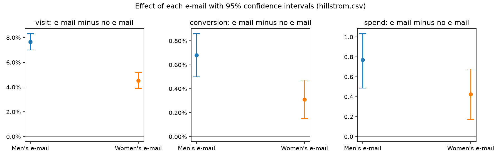
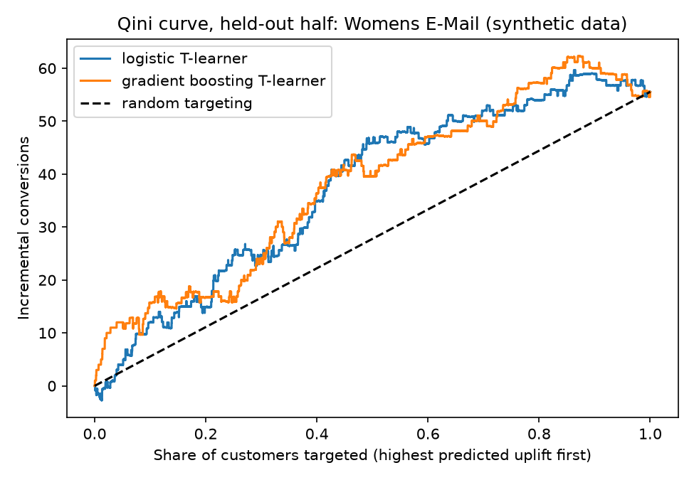
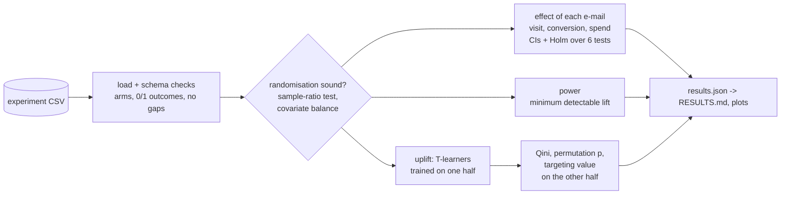

# Randomised e-mail campaign: effects, power and uplift

Analysis of a three-arm randomised marketing experiment, done the way a
careful analyst would before anyone acts on it: check the randomisation,
estimate each e-mail's effect with confidence intervals and a multiple-testing
correction, state what the experiment was large enough to detect, then ask
**for whom** the e-mail works, using uplift models judged on held-out
customers.

Originally developed as part of my MSc Data Science at Coventry University, then extended into a standalone project.

The data is the Hillstrom (MineThatData, 2008) e-mail experiment. As its
publisher describes it, 64,000 recent customers were randomly split into three
equal arms (a men's merchandise e-mail, a women's merchandise e-mail, or no
e-mail), and visits, purchases and spend were recorded for two weeks. The file
is not redistributed here (no licence is stated); `make data` downloads it.
The copy analysed had 64,000 rows and SHA-256 `0e589332…291aece`.

## Results

Full tables: [`evidence/hillstrom/RESULTS.md`](evidence/hillstrom/RESULTS.md).

**The experiment is sound.** The arms hold 21,306 / 21,307 / 21,387 customers
(sample-ratio mismatch test p = 0.904 against a 1/3 split), and no
pre-treatment covariate differs between an e-mail arm and control by more than
0.009 standard deviations.

**Both e-mails work, and the men's e-mail works better on every outcome.**
Differences against no e-mail, with 95% intervals and Holm-adjusted p-values
over all six comparisons:

| | Men's e-mail | Women's e-mail |
|---|---|---|
| Visit rate (control 10.62%) | **+7.66 points** (7.00 to 8.32), +72% | +4.52 points (3.89 to 5.16), +43% |
| Conversion rate (control 0.57%) | **+0.68 points** (0.50 to 0.86), +119%, p = 6.1e-13 | +0.31 points (0.15 to 0.47), +54%, p = 0.00031 |
| Spend per customer (control 0.65) | **+0.77** (0.49 to 1.03), +118% | +0.42 (0.17 to 0.68), +65% |



The conversion intervals of the two e-mails do not overlap. Both are measured
against the same control group, which makes non-overlap a conservative sign
that the men's e-mail converts better. The experiment could detect a
conversion lift of 0.224 points (80% power, 5% significance), and both
e-mails clear it.

**"For whom?" has no reliable answer in this data.** Uplift models trained on
half the customers and scored on the other half:

| E-mail | Model | Qini coefficient | Qini p | Uplift in the top 10% targeted | Average uplift |
|---|---|---:|---:|---:|---:|
| Men's | logistic T-learner | −0.073 | 0.899 | 0.57% | 0.69% |
| Men's | gradient boosting T-learner | −0.024 | 0.664 | 0.15% | 0.69% |
| Women's | logistic T-learner | 0.168 | 0.053 | 0.97% | 0.32% |
| Women's | gradient boosting T-learner | 0.176 | 0.042 | 0.34% | 0.32% |

The Qini p is the share of 1,000 random rankings of the same held-out
customers that score at least as high. For the men's e-mail the models do
no better than random. For the women's e-mail the curves sit above random, but
only at p = 0.04–0.05 before allowing for four model comparisons. The two
models also disagree about whether the top 10% respond more (0.97% vs 0.34%).
The held-out half contains only about 34 incremental conversions from the
women's e-mail, too few to rank customers reliably.

What the data supports: of the options tested, **the men's e-mail sent to
everyone** has the largest measured effect on visits, conversions and spend.
Whether that pays depends on e-mail costs and margins this data doesn't have.
A targeted campaign would need a larger test, or one designed around a
segment chosen in advance.

## Does the pipeline find effects that are known to be there?

The synthetic experiment (`abtest.data.synthetic`, 64,000 customers, Hillstrom
column layout) has two planted effects. The men's e-mail lifts conversion by
0.40 points for everyone. The women's e-mail lifts conversion by 1.2 points,
but **only** for customers who bought women's merchandise before
(`womens == 1`, about half), so about 0.6 points on average. The same code
that analysed the real data recovers both:

| Check | Planted | Estimated |
|---|---|---|
| Arms match the intended 1/3 split | yes | sample-ratio mismatch test p = 0.611 |
| Pre-treatment covariates balanced | yes | largest \|standardised mean difference\| 0.010 (threshold 0.1) |
| Men's e-mail, conversion lift | +0.40 points | **+0.44** points (95% CI 0.27 to 0.62), Holm p = 2.3e-06 |
| Women's e-mail, conversion lift | about +0.6 points on average | **+0.51** points (95% CI 0.33 to 0.69), Holm p = 7.8e-08 |
| Men's e-mail: any segment that responds more? | no | Qini −0.066 and 0.019 (Qini p 0.775 and 0.398): no better than random targeting |
| Women's e-mail: is the effect concentrated? | yes, 1.2 points in half the customers | Qini 0.171 and 0.182 (Qini p 0.008 and 0.005); the top 10% by predicted uplift show **1.12–1.44** points |



The power check reports that with 21,248 customers per arm and a 0.64% control
conversion rate, the smallest lift detectable with 80% power at 5%
significance is 0.236 points absolute (37% relative). Both planted conversion
effects are above it, so both should be found, and both are.

The contrast with the real data is the point of this check. With a segment
that really responds more, the same models on the same number of customers
reach Qini p below 0.01. On the real women's e-mail they reach only 0.04–0.05.

Full tables: [`evidence/synthetic_check/RESULTS.md`](evidence/synthetic_check/RESULTS.md).

## The analysis, step by step



1. **Is the experiment sound?** A chi-square sample-ratio mismatch test
   against the intended 1/3 split, and the standardised mean difference of
   every pre-treatment covariate between each e-mail arm and control.
2. **What did each e-mail do?** Visit and conversion as differences in
   proportions (Wald interval, pooled z-test); spend as a difference in means
   with a bootstrap interval, because it is mostly zeros with a long tail.
   Holm's correction across all six comparisons.
3. **Was it big enough?** The minimum detectable conversion lift at 80% power,
   solved from the same sample-size formula the tests check against the
   textbook value.
4. **For whom?** Two T-learners (logistic regression and gradient boosting)
   estimate each customer's uplift from pre-treatment features only. They are
   trained on half the customers and judged on the other half by the Qini
   coefficient, a permutation test of it against random rankings, and the
   measured effect among the top 10/30/50% they would target.

| Component | Version |
|---|---|
| Python | 3.12 (in Docker) |
| NumPy / pandas / SciPy | 2.5.4 / 3.0.6 / 1.18.1 |
| scikit-learn | 1.9.1 |
| matplotlib | 3.11.2 |

## Quickstart

Requirements: Docker and GNU make.

```bash
make test             # 17 tests, expected values worked out by hand
make synthetic-check  # the planted-effect check above -> evidence/synthetic_check/
make data             # download the Hillstrom CSV into data/ (about 4 MB)
make run              # analyse it -> evidence/hillstrom/
```

## Key design decisions

Short decision records are in [`docs/decisions/`](docs/decisions).

1. **Check the randomisation before reading any effect**
   ([ADR 1](docs/decisions/0001-check-the-randomisation-first.md)). A
   sample-ratio mismatch means assignment broke, and no effect estimate can be
   trusted until it is explained.
2. **Intervals and a multiple-testing correction, not single p-values**
   ([ADR 2](docs/decisions/0002-intervals-and-holm-correction.md)). Six
   independent comparisons at 5% each would give a 26% chance of at least one
   false positive if nothing worked.
3. **Uplift judged on customers the models never saw**
   ([ADR 3](docs/decisions/0003-uplift-judged-on-held-out-customers.md)).
   Uplift cannot be observed for one customer, so models are compared by the
   Qini curve, tested against random rankings, and by measured effects in the
   groups they would target.
4. **Prove the pipeline on planted effects before trusting it on real data**
   ([ADR 4](docs/decisions/0004-validate-on-planted-effects.md)).

## Project layout

```
src/abtest/stats.py        sample-ratio test, balance, proportions, means, Holm, power
src/abtest/uplift.py       T-learner, Qini curve, coefficient and permutation test, targeting value
src/abtest/data.py         loading and checks, model matrix, synthetic experiment
scripts/run_analysis.py    the four steps -> results.json and plots
scripts/report.py          results.json -> RESULTS.md (every number traced to the JSON)
tests/                     hand-worked statistics, Qini by hand, planted-effect recovery
evidence/hillstrom/        results on the real experiment
evidence/synthetic_check/  the planted-effect check (synthetic data, labelled as such)
docs/decisions/            architecture decision records
```

## Known limitations

- **The uplift question is underpowered.** About 150-200 conversions per
  held-out half are enough to measure average effects, not to rank
  customers. The permutation p-values are for a single model each; with four
  models compared, none would survive a correction.
- **Synthetic effects are simple.** One planted segment and a uniform effect
  are easy for a T-learner. Real heterogeneity is usually weaker and spread
  across many features, as the real results show.
- **No costs or margins.** Effects are in visits, conversions and spend, not
  profit.
- **Two-week outcomes only.** The data cannot say whether the e-mail moved
  purchases forward in time rather than creating new ones.
- **Wald intervals** are accurate at these sample sizes but would be replaced
  by Wilson or Newcombe intervals for small arms.

## What I would do next

1. **Other uplift learners** (X-learner, causal forest) compared on the same
   held-out Qini, with cross-fitting so every customer is scored out of
   sample and twice the data is used for evaluation.
2. **Spend uplift** as well as conversion: the men's e-mail's spend effect
   may be concentrated even where conversion uplift is not.
3. **Cost-aware targeting**: with a cost per e-mail and a margin per purchase,
   choose the share to target that maximises incremental profit, with an
   interval from the bootstrap.
4. **Sequential testing** (for example an always-valid confidence sequence),
   so a live experiment can be stopped early without inflating false positives.
