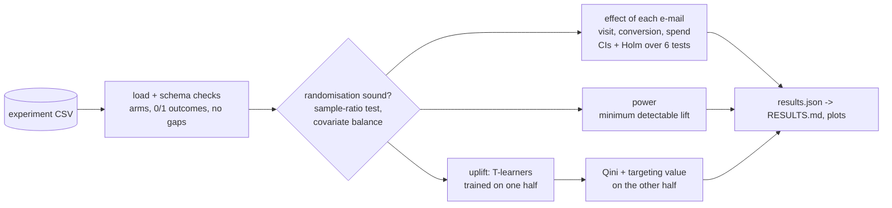

# Randomised e-mail campaign: effects, power and uplift

Analysis of a three-arm randomised marketing experiment, done the way a
careful analyst would before anyone acts on it: check the randomisation,
estimate each e-mail's effect with confidence intervals and a multiple-testing
correction, state what the experiment was large enough to detect, then ask
**for whom** the e-mail works, using uplift models judged on held-out
customers.

Originally developed as part of my MSc Data Science at Coventry University, then extended into a standalone project.

The target data is the Hillstrom (MineThatData, 2008) e-mail experiment. As
its publisher describes it, 64,000 recent customers were randomly split into
three equal arms (a men's merchandise e-mail, a women's merchandise e-mail, or
no e-mail), and visits, purchases and spend were recorded for two weeks.

## Status of the results

| Data | Status |
|---|---|
| Synthetic experiment with **planted** effects | Run. Results below and in [`evidence/synthetic_check/`](evidence/synthetic_check/RESULTS.md) |
| Hillstrom e-mail experiment | Not run yet. The file is not redistributed here (no licence is stated); `make data` downloads it and `make run` writes the results to `evidence/hillstrom/` |

No number from the real experiment appears anywhere in this repository until
`make run` has produced it.

## Does the pipeline find effects that are known to be there?

The synthetic experiment (`abtest.data.synthetic`, 64,000 customers, Hillstrom
column layout) has two planted effects. The men's e-mail lifts conversion by
0.40 points for everyone. The women's e-mail lifts conversion by 1.2 points,
but **only** for customers who bought women's merchandise before
(`womens == 1`, about half), so about 0.6 points on average. The same code
that will analyse the real data recovers both:

| Check | Planted | Estimated |
|---|---|---|
| Arms match the intended 1/3 split | yes | sample-ratio mismatch test p = 0.611 |
| Pre-treatment covariates balanced | yes | largest \|standardised mean difference\| 0.010 (threshold 0.1) |
| Men's e-mail, conversion lift | +0.40 points | **+0.44** points (95% CI 0.27 to 0.62), Holm p = 2.3e-06 |
| Women's e-mail, conversion lift | about +0.6 points on average | **+0.51** points (95% CI 0.33 to 0.69), Holm p = 7.8e-08 |
| Men's e-mail: any segment that responds more? | no | Qini coefficient −0.066 and 0.019: no better than random targeting |
| Women's e-mail: is the effect concentrated? | yes, 1.2 points in half the customers | Qini 0.171 (logistic) and 0.182 (gradient boosting); the top 10% by predicted uplift show **1.12–1.44** points |


The power check reports that with 21,248 customers per arm and a 0.64% control
conversion rate, the smallest lift detectable with 80% power at 5%
significance is 0.236 points absolute (37% relative). Both planted conversion
effects are above it, so both should be found, and both are.

Full tables: [`evidence/synthetic_check/RESULTS.md`](evidence/synthetic_check/RESULTS.md).

## The analysis, step by step



1. **Is the experiment sound?** A chi-square sample-ratio mismatch test
   against the intended 1/3 split, and the standardised mean difference of
   every pre-treatment covariate between each e-mail arm and control.
2. **What did each e-mail do?** Visit and conversion as differences in
   proportions (Wald interval, pooled z-test); spend as a difference in means
   with a bootstrap interval, because it is mostly zeros with a long tail.
   Holm's correction across all six comparisons.
3. **Was it big enough?** The minimum detectable conversion lift at 80% power,
   solved from the same sample-size formula the tests check against the
   textbook value.
4. **For whom?** Two T-learners (logistic regression and gradient boosting)
   estimate each customer's uplift from pre-treatment features only. They are
   trained on half the customers and judged on the other half by the Qini
   coefficient and by the measured effect among the top 10/30/50% they
   would target.

| Component | Version |
|---|---|
| Python | 3.12 (in Docker) |
| NumPy / pandas / SciPy | 2.5.4 / 3.0.6 / 1.18.1 |
| scikit-learn | 1.9.1 |
| matplotlib | 3.11.2 |

## Quickstart

Requirements: Docker and GNU make.

```bash
make test             # 16 tests, expected values worked out by hand
make synthetic-check  # the planted-effect check above -> evidence/synthetic_check/
make data             # download the Hillstrom CSV into data/ (about 4 MB)
make run              # analyse it -> evidence/hillstrom/
```

## Key design decisions

Short decision records are in [`docs/decisions/`](docs/decisions).

1. **Check the randomisation before reading any effect**
   ([ADR 1](docs/decisions/0001-check-the-randomisation-first.md)). A
   sample-ratio mismatch means assignment broke, and no effect estimate can be
   trusted until it is explained.
2. **Intervals and a multiple-testing correction, not single p-values**
   ([ADR 2](docs/decisions/0002-intervals-and-holm-correction.md)). Six
   independent comparisons at 5% each would give a 26% chance of at least one
   false positive if nothing worked.
3. **Uplift judged on customers the models never saw**
   ([ADR 3](docs/decisions/0003-uplift-judged-on-held-out-customers.md)).
   Uplift cannot be observed for one customer, so models are compared by the
   Qini curve and by measured effects in the groups they would target.
4. **Prove the pipeline on planted effects before trusting it on real data**
   ([ADR 4](docs/decisions/0004-validate-on-planted-effects.md)).

## Project layout

```
src/abtest/stats.py        sample-ratio test, balance, proportions, means, Holm, power
src/abtest/uplift.py       T-learner, Qini curve and coefficient, targeting value
src/abtest/data.py         loading and checks, model matrix, synthetic experiment
scripts/run_analysis.py    the four steps -> results.json and plots
scripts/report.py          results.json -> RESULTS.md (every number traced to the JSON)
tests/                     hand-worked statistics, Qini by hand, planted-effect recovery
evidence/synthetic_check/  the planted-effect check (synthetic data, labelled as such)
docs/decisions/            architecture decision records
```

## Known limitations

- **Real-data results are pending** (see Status). The synthetic check shows
  the method works when its assumptions hold; it says nothing about the real
  campaign.
- **Synthetic effects are simple.** One planted segment and a uniform effect
  are easy for a T-learner. Real heterogeneity is usually weaker and spread
  across many features, so Qini coefficients on real data should be expected
  to be smaller.
- **Two-week outcomes only.** The data cannot say whether the e-mail moved
  purchases forward in time rather than creating new ones.
- **Wald intervals** are accurate at these sample sizes but would be replaced
  by Wilson or Newcombe intervals for small arms.

## What I would do next

1. **Run on the real experiment** and report it alongside the synthetic check.
2. **Other uplift learners** (X-learner, causal forest) compared on the same
   held-out Qini.
3. **Cost-aware targeting**: with a cost per e-mail and a margin per purchase,
   choose the share to target that maximises incremental profit, with an
   interval from the bootstrap.
4. **Sequential testing** (for example an always-valid confidence sequence),
   so a live experiment can be stopped early without inflating false positives.
